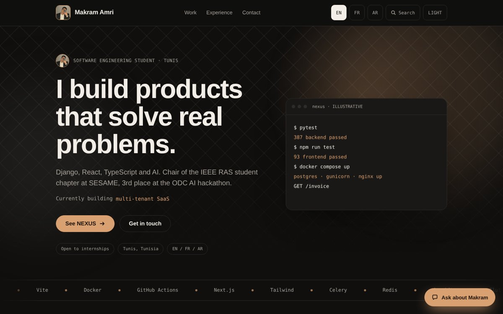

<div align="center">

# Makram Amri, Portfolio

**Software engineering student in Tunis building full-stack products with Django, React, TypeScript and AI.**

[](https://react.dev)
[](https://esbuild.github.io)
[](https://vercel.com)
[-D9A071)](#features)



</div>

## About this project

This is the source of my personal portfolio. It presents my projects as short case studies, with the decisions behind them, instead of a plain list of links. The whole site is one small static app: no backend, no database, nothing to run on a server.

## Features

- **Three languages.** English, French and Arabic, with a full right-to-left layout for Arabic. The switch is instant and keeps your place on the page.
- **Dark and light themes** with a warm copper palette.
- **Case studies** for NEXUS, NutriScan, AI Background Remover, Food Delivery System and TunisIA, each with the problem, the approach and the stack.
- **NEXUS deep dive:** an animated tenant-isolation demo, an architecture walkthrough, a design-decisions panel and real screenshots (demo data only).
- **"Ask about Makram" assistant.** A scripted assistant that answers from the page content in all three languages. It has a keyword knowledge base, typo-tolerant matching and suggested questions. No API key and no server.
- **Command palette** (search) and an interactive **terminal** for quick navigation.
- **Motion with restraint:** a hand-drawn "hello" intro, scroll-driven reveals, count-up stats and a typed terminal. Everything switches off for visitors who prefer reduced motion.
- **Fast first paint.** The page is prerendered to HTML at build time, then React takes over in the browser.
- **Analytics hooks.** Key actions send events to [Plausible](https://plausible.io) or [Umami](https://umami.is) if either script is on the page, and do nothing otherwise.

## Tech stack

| Area | Choice |
| --- | --- |
| UI | React 19 |
| Build | esbuild (bundle, minify, prerender) |
| Styling | Plain CSS with CSS variables for both themes |
| Fonts | Bricolage Grotesque, Instrument Sans, JetBrains Mono, Noto Sans Arabic |
| Hosting | Vercel (static output) |

## Getting started

You need [Node.js](https://nodejs.org) 18 or newer.

```bash
git clone https://github.com/Ing-Makram/Makram-Amri-Portfolio.git
cd Makram-Amri-Portfolio
npm install
npm run build        # writes the site to ./dist
npx serve dist       # preview at http://localhost:3000
```

## Deploy on Vercel

1. Push this repository to GitHub.
2. On [vercel.com](https://vercel.com) choose **Add New, Project** and import the repository.
3. Click **Deploy**. The settings come from `vercel.json` (build command `npm run build`, output directory `dist`).
4. Optional: add your own domain under **Settings, Domains**.

On Vercel the link-preview image (`og.jpg`) gets an absolute URL automatically. To set it yourself, define `SITE_URL` (for example `https://makramamri.com`) as an environment variable.

## Project structure

```
.
├── build.mjs            # build script: bundle, prerender, write dist/
├── vercel.json          # Vercel build settings
├── public/              # copied as is to dist/
│   ├── styles.css       # all styles; theme colors are the first lines
│   ├── makram.jpg       # portrait
│   ├── nexus-*.jpg      # NEXUS screenshots (demo data)
│   ├── og.jpg           # link-preview image
│   └── favicon.svg
├── src/
│   ├── template.json    # the page markup
│   ├── logic.js         # texts (EN/FR/AR), assistant, terminal, behavior
│   ├── runtime.jsx      # renders the markup with React
│   ├── dc.js            # small state helper used by logic.js
│   ├── main.jsx         # browser entry
│   └── prerender.jsx    # build-time entry for the first paint
├── tools/convert.py     # converter used to generate src/ from the original design file
└── docs/preview.jpg     # screenshot used in this README
```

## Customize

- **Colors:** edit the `.t-dark` and `.t-light` lines at the top of `public/styles.css`.
- **Texts and translations:** in `src/logic.js`, each string has an `en`, `fr` and `ar` version.
- **Assistant answers:** the `KB` list in `src/logic.js` holds the questions, keywords and answers.
- **Photo and images:** replace the files in `public/` and keep the same names.
- **Analytics:** add your Plausible or Umami script tag to the HTML template in `build.mjs`.

## Privacy

The NEXUS screenshots use demo data only. No cookies are set and no personal data is collected by the site itself.

## Contact

- Email: makremamri08@gmail.com
- GitHub: [@Ing-Makram](https://github.com/Ing-Makram)
- Based in Tunis, Tunisia, open to software engineering internships.

## License

All rights reserved for the content, texts and images (c) Makram Amri. The code structure may be used as a reference, but please do not republish the site with my name, photo or texts.
